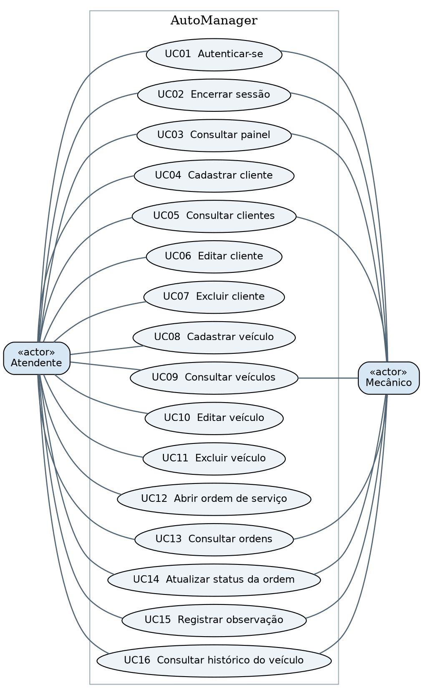
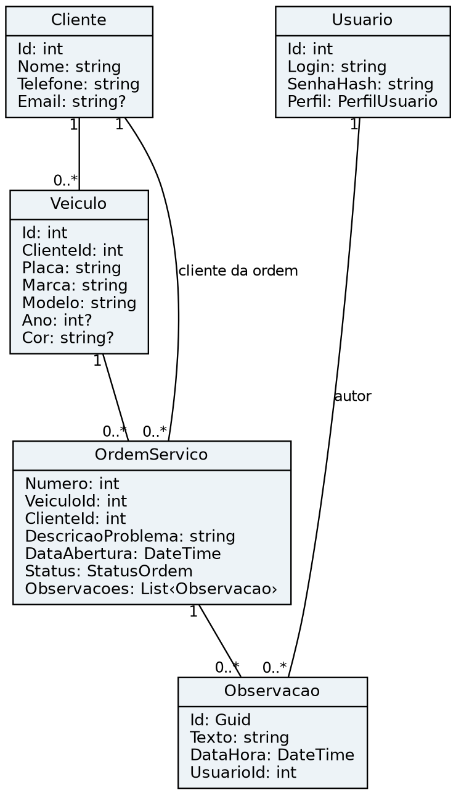

<section class="cover">

UNIFRAN – UNIVERSIDADE DE FRANCA

<h1>AutoManager</h1>

Sistema Web de Gerenciamento de Oficina Mecânica

João Pedro da Silva

Disciplina: Análise e Projeto de Sistemas

Docente: Euller Da Silva Ferreira

Modalidade: individual

Repositório GitHub: <a href="https://github.com/silvajoaopedro/AutoManager">https://github.com/silvajoaopedro/AutoManager</a>

Franca – SP | 2026

</section>

# 1- Descrição do projeto

## 1.1 - Contexto e problema

Oficinas mecânicas precisam organizar clientes, veículos e serviços realizados. Registros em
papel ou arquivos separados dificultam a consulta de atendimentos anteriores e o
acompanhamento das ordens de serviço. O AutoManager centraliza essas informações para
apoiar o trabalho de atendentes e mecânicos desde a abertura até a conclusão do
atendimento.

## 1.2 - Objetivo

Desenvolver uma aplicação web que organize clientes, veículos e ordens de serviço,
preserve o histórico dos atendimentos e permita acompanhar o andamento dos serviços
conforme o perfil do usuário.

## 1.3 - Escopo

O AutoManager contempla autenticação de usuários, encerramento de sessão e controle de
acesso pelos perfis Atendente e Mecânico. Permite cadastrar, consultar, editar e excluir
clientes e veículos, respeitando as permissões de cada perfil e as restrições de exclusão de
registros com vínculos.

O sistema permite abrir e consultar ordens de serviço, atualizar seus status, registrar
observações, consultar o histórico de ordens por veículo e visualizar um painel com a
quantidade de ordens em cada status. Os dados serão armazenados em arquivos JSON no
servidor, sem utilização de banco de dados.

A edição de veículos não permitirá alterar o proprietário vinculado. Ordens de serviço
concluídas permanecerão disponíveis para consulta, mas não poderão ser reabertas ou
modificadas, inclusive quanto às suas observações.

Não fazem parte do escopo o cadastro de usuários pela interface, controle de estoque,
elaboração de orçamentos, cobrança, gestão financeira, emissão de notas fiscais,
agendamento, notificações automáticas, acesso de clientes ao sistema ou integrações
externas.

## 1.4 - Perfis de acesso

Atendente: realiza a manutenção de clientes e veículos, abre ordens e utiliza as consultas, o
painel e a atualização de ordens. Mecânico: consulta clientes, veículos, ordens e histórico,
visualiza o painel e atualiza status e observações de ordens ainda não concluídas. As contas
serão previamente configuradas, com senhas armazenadas por hash com salt.

# 2 - Requisitos

## 2.1 - Requisitos funcionais

**RF-01 — Autenticar usuário**

O sistema deve autenticar usuários dos perfis Atendente e Mecânico por meio de
login e senha.

**RF-02 — Encerrar sessão**

O sistema deve permitir que o usuário autenticado encerre sua sessão no
sistema.

**RF-03 — Controlar permissões de acesso**

O sistema deve controlar o acesso às funcionalidades do sistema conforme o
perfil do usuário autenticado.

**RF-04 — Cadastrar cliente**

O sistema deve permitir exclusivamente ao Atendente cadastrar clientes,
informando obrigatoriamente nome e telefone. O e-mail é opcional.

**RF-05 — Consultar clientes**

O sistema deve permitir ao Atendente e ao Mecânico consultar os clientes
cadastrados no sistema.

**RF-06 — Cadastrar veículo**

O sistema deve permitir exclusivamente ao Atendente cadastrar veículos,
informando placa, marca e modelo e vinculando cada veículo a um cliente previamente
cadastrado. Ano e cor são opcionais.

**RF-07 — Consultar veículos**

O sistema deve permitir ao Atendente e ao Mecânico consultar os veículos
cadastrados e seus respectivos proprietários.

**RF-08 — Abrir ordem de serviço**

O sistema deve permitir exclusivamente ao Atendente abrir ordens de serviço,
selecionando um veículo cadastrado e informando o problema relatado, com geração
automática de número único, registro da data de abertura e status inicial Pendente.

**RF-09 — Consultar ordens de serviço**

O sistema deve permitir ao Atendente e ao Mecânico consultar as ordens de
serviço cadastradas e visualizar suas informações detalhadas.

**RF-10 — Atualizar ordem de serviço**

O sistema deve permitir ao Atendente e ao Mecânico atualizar o status e
registrar observações nas ordens de serviço, desde que não estejam concluídas e sejam
respeitadas as regras de transição.

**RF-11 — Consultar histórico do veículo**

O sistema deve permitir ao Atendente e ao Mecânico consultar o histórico de
serviços de cada veículo, incluindo ordens concluídas e respectivas observações.

**RF-12 — Consultar painel por status**

O sistema deve disponibilizar ao Atendente e ao Mecânico painel inicial com a
quantidade de ordens Pendente, Em andamento e Concluída.

**RF-13 — Editar cliente**

O sistema deve permitir exclusivamente ao Atendente editar o nome e o telefone
dos clientes cadastrados. O e-mail é opcional.

**RF-14 — Excluir cliente**

O sistema deve permitir exclusivamente ao Atendente excluir clientes sem
veículos vinculados, mediante confirmação.

**RF-15 — Editar veículo**

O sistema deve permitir exclusivamente ao Atendente editar placa, marca e
modelo dos veículos, mantendo vínculo com o proprietário. Ano e cor são opcionais.

**RF-16 — Excluir veículo**

O sistema deve permitir exclusivamente ao Atendente excluir veículos sem
ordens de serviço vinculadas, mediante confirmação.

## 2.2 - Requisitos não funcionais

**RNF-01 — Tecnologia da aplicação**

Desenvolver a aplicação em C# e ASP.NET Core MVC, com páginas Razor,
comprovando a compilação e a execução local.

**RNF-02 — Compatibilidade com navegadores**

Executar os fluxos de login, clientes, veículos e ordens nas versões estáveis de
Chrome e Edge utilizadas na validação, sem erros que impeçam sua conclusão; registrar as
versões testadas.

**RNF-03 — Padronização das interfaces**

Manter nas telas internas menu consistente, rótulos visíveis nos campos e
identificação textual dos botões de salvar, cancelar e excluir, verificados por inspeção.

**RNF-04 — Responsividade das interfaces**

Permitir executar login e operações principais em larguras de 360 e 1366 pixels
sem sobreposição de controles ou perda de acesso às ações; tabelas poderão usar rolagem
horizontal.

**RNF-05 — Proteção das páginas internas**

Redirecionar ao login qualquer acesso sem sessão válida às páginas internas,
incluindo solicitações diretas por URL.

**RNF-06 — Autorização no servidor**

Validar permissões no servidor em todas as operações protegidas, recusando
acesso do Mecânico às operações exclusivas do Atendente, inclusive por requisição direta.

**RNF-07 — Persistência em arquivos JSON**

Armazenar os arquivos JSON fora de wwwroot, sem banco de dados e sem
permitir seu download por URL pública.

**RNF-08 — Validação antes da gravação**

Validar os campos obrigatórios e as regras de integridade no servidor antes de
gravar; uma operação inválida não deverá alterar os dados persistidos.

**RNF-09 — Persistência após reinicialização**

Preservar registros e a sequência de numeração das ordens após reiniciar a
aplicação, conferindo os dados antes e depois da reinicialização.

**RNF-10 — Organização da arquitetura**

Organizar a aplicação em Models, Views e Controllers, isolando leitura e
gravação JSON em classe própria e regras de domínio em modelos e serviços.

**RNF-11 — Proteção das senhas**

Armazenar apenas hashes de senha com salt gerados por
PasswordHasher<Usuario>, verificando a ausência de senhas em texto puro nos arquivos de
usuários.

**RNF-12 — Tratamento de mensagens e erros**

Apresentar mensagens de validação compreensíveis e respostas genéricas a
falhas inesperadas, sem exibir senhas, stack traces ou caminhos internos ao usuário.

## 2.3 - Regras de negócio

**RN-01 — Acesso autenticado**

Somente usuários com credenciais válidas poderão acessar as funcionalidades
internas.

**RN-02 — Perfis de usuário**

Cada usuário deverá possuir perfil Atendente ou Mecânico.

**RN-03 — Manutenção de clientes pelo Atendente**

Cadastro, edição e exclusão de clientes serão exclusivos do Atendente.

**RN-04 — Manutenção de veículos pelo Atendente**

Cadastro, edição e exclusão de veículos serão exclusivos do Atendente.

**RN-05 — Abertura de ordens pelo Atendente**

A abertura de ordens de serviço será exclusiva do Atendente.

**RN-06 — Consultas compartilhadas**

Atendente e Mecânico poderão consultar clientes, veículos, ordens, histórico e
painel inicial.

**RN-07 — Atualização compartilhada de ordens**

Atendente e Mecânico poderão atualizar status e registrar observações nas
ordens ainda não concluídas.

**RN-08 — Dados obrigatórios do cliente**

Nome e telefone do cliente serão obrigatórios no cadastro e edição.

**RN-09 — Dados obrigatórios do veículo**

Placa, marca e modelo do veículo serão obrigatórios no cadastro e edição.

**RN-10 — Vínculo entre veículo e proprietário**

Todo veículo deverá estar vinculado a cliente cadastrado; a edição preservará o
vínculo com o proprietário.

**RN-11 — Unicidade da placa**

A placa será única, comparada sem distinção de maiúsculas/minúsculas,
espaços e hífens; na edição, desconsidera-se o próprio veículo.

**RN-12 — Restrição à exclusão de cliente**

Cliente somente poderá ser excluído quando não possuir veículos vinculados.

**RN-13 — Restrição à exclusão de veículo**

Veículo somente poderá ser excluído quando não possuir ordens vinculadas,
independentemente do status.

**RN-14 — Confirmação das exclusões**

Exclusões de clientes e veículos exigirão confirmação do Atendente.

**RN-15 — Vínculo entre ordem e veículo**

Toda ordem deverá estar vinculada a veículo cadastrado.

**RN-16 — Numeração única das ordens**

Cada ordem terá número único gerado automaticamente, persistido entre
execuções e nunca reutilizado.

**RN-17 — Problema relatado obrigatório**

A descrição do problema relatado será obrigatória na abertura e terá de 10 a 1.000 caracteres.

**RN-18 — Data de abertura automática**

A data de abertura será automática e não poderá ser alterada.

**RN-19 — Status inicial da ordem**

Toda ordem será criada com status Pendente.

**RN-20 — Status permitidos**

Os únicos status serão Pendente, Em andamento e Concluída.

**RN-21 — Sequência das mudanças de status**

Mudanças de status seguirão Pendente → Em andamento → Concluída, sem
retrocessos ou saltos.

**RN-22 — Observação sem mudança de status**

Observações poderão ser registradas em ordens não concluídas sem mudança de status.

**RN-23 — Observação obrigatória na conclusão**

A conclusão exigirá uma observação de 10 a 1.000 caracteres sobre o serviço realizado na própria operação;
sem ela, a conclusão será recusada.

**RN-24 — Proibição de reabertura**

Ordem concluída não poderá ser reaberta nem ter status alterado.

**RN-25 — Imutabilidade das observações após conclusão**

Após a conclusão, observações não poderão ser incluídas, alteradas ou
removidas.

**RN-26 — Preservação do histórico**

Ordens concluídas permanecerão disponíveis no histórico do respectivo veículo.

**RN-27 — Contagem das ordens por status**

O painel mostrará o total de ordens em cada status, considerando o status atual
de todas as ordens.

# 3 - Casos de uso

## 3.1 - Atores e permissões

Atendente e Mecânico são atores humanos distintos. Ambos precisam de autenticação para
executar funções internas. A autorização é uma pré-condição dessas funções e deve ser
verificada no servidor. Não há ator cliente nem sistema externo no escopo.

## 3.2 - Catálogo de casos de uso

| Código | Caso de uso | Ator | Requisito |
|---|---|---|---|
| UC01 | Autenticar-se | Atendente e Mecânico | RF-01 |
| UC02 | Encerrar sessão | Atendente e Mecânico | RF-02 |
| UC03 | Consultar painel | Atendente e Mecânico | RF-12 |
| UC04 | Cadastrar cliente | Atendente | RF-04 |
| UC05 | Consultar clientes | Atendente e Mecânico | RF-05 |
| UC06 | Editar cliente | Atendente | RF-13 |
| UC07 | Excluir cliente | Atendente | RF-14 |
| UC08 | Cadastrar veículo | Atendente | RF-06 |
| UC09 | Consultar veículos | Atendente e Mecânico | RF-07 |
| UC10 | Editar veículo | Atendente | RF-15 |
| UC11 | Excluir veículo | Atendente | RF-16 |
| UC12 | Abrir ordem de serviço | Atendente | RF-08 |
| UC13 | Consultar ordens | Atendente e Mecânico | RF-09 |
| UC14 | Atualizar status da ordem | Atendente e Mecânico | RF-10 |
| UC15 | Registrar observação | Atendente e Mecânico | RF-10 |
| UC16 | Consultar histórico do veículo | Atendente e Mecânico | RF-11 |

## 3.3 - Diagrama de casos de uso

{ width=81% }

## 3.4 - Relacionamentos entre casos de uso

Os atores Atendente e Mecânico ficarão fora da fronteira do sistema AutoManager. O
Atendente será associado a todos os casos de uso do catálogo. O Mecânico será associado
a UC01, UC02, UC03, UC05, UC09, UC13, UC14, UC15 e UC16.

A autenticação será pré-condição dos casos internos. A observação exigida ao concluir uma
ordem será parte do fluxo de UC14; não haverá include entre UC14 e UC15, pois a
passagem de Pendente para Em andamento não exige observação. UC15 permitirá registrar
observação sem alterar o status. Não se utilizarão extend ou generalização sem necessidade
no modelo.

## 3.5 - UC04 Cadastrar cliente

Ator: Atendente

Rastreabilidade: RF-04; RN-03 e RN-08

Pré-condições: Atendente autenticado e autorizado.

Gatilho: O Atendente seleciona Cadastrar cliente.

**Fluxo principal**

1. O sistema apresenta os campos nome e telefone.

2. O Atendente informa os dados e solicita salvar.

3. O sistema valida os campos no servidor e gera identificador único.

4. O sistema grava o cliente no arquivo JSON e confirma o cadastro.

**Fluxos alternativos**

A1 Cancelamento: antes de salvar, o Atendente cancela; o sistema retorna à consulta sem
gravar.

**Exceções**

E1 Nome ou telefone vazio: o sistema destaca os campos e permite corrigir sem gravar.

E2 Sessão inválida ou perfil Mecânico: o sistema bloqueia a operação.

E3 Falha de persistência: o sistema informa que o cadastro não foi concluído e preserva o
arquivo anterior.

**Pós-condições**

Cliente gravado e disponível para consulta e vínculo com veículos. Em cancelamento ou
exceção, nenhum cliente é criado.

## 3.6 - UC08 Cadastrar veículo

Ator: Atendente

Rastreabilidade: RF-06; RN-04 e RN-09 a RN-11

Pré-condições: Atendente autenticado; pelo menos um cliente cadastrado.

Gatilho: O Atendente seleciona Cadastrar veículo.

**Fluxo principal**

1. O sistema solicita placa, marca, modelo e proprietário.

2. O Atendente informa os dados, seleciona um cliente e solicita salvar.

3. O sistema valida os campos, confirma a existência do cliente e normaliza a placa
removendo espaços e hífens e convertendo para maiúsculas.

4. O sistema verifica se a placa normalizada já existe.

5. O sistema gera identificador, grava o veículo vinculado ao cliente e confirma.

**Fluxos alternativos**

A1 Cancelamento: o Atendente cancela antes da confirmação e retorna à consulta sem
gravar.

**Exceções**

E1 Campos obrigatórios vazios: o sistema permite corrigir sem gravar.

E2 Placa já cadastrada: o sistema recusa a operação e informa a duplicidade.

E3 Cliente inexistente ou removido antes da gravação: o sistema exige selecionar um cliente
válido.

E4 Sessão inválida, acesso indevido ou falha de gravação: o sistema bloqueia a operação e
preserva os dados anteriores.

**Pós-condições**

Veículo cadastrado com proprietário válido e placa única. Em falha ou cancelamento,
nenhum veículo é criado.

## 3.7 - UC12 Abrir ordem de serviço

Ator: Atendente

Rastreabilidade: RF-08; RN-05 e RN-15 a RN-20

Pré-condições: Atendente autenticado; veículo e respectivo proprietário cadastrados.

Gatilho: O Atendente seleciona Abrir ordem de serviço.

**Fluxo principal**

1. O sistema apresenta a seleção de veículo e o campo problema relatado.

2. O Atendente seleciona o veículo, descreve o problema e confirma.

3. O sistema valida o problema e a existência do veículo no servidor.

4. Dentro de uma operação exclusiva, o sistema incrementa o último número persistido,
registra a data e hora e define o status Pendente.

5. O sistema grava a ordem e o novo contador conjuntamente.

6. O sistema exibe a ordem criada, com número, veículo, data e status.

**Fluxos alternativos**

A1 Cancelamento: o Atendente cancela antes de confirmar; nenhuma ordem é criada.

**Exceções**

E1 Problema vazio: o sistema solicita preenchimento sem criar a ordem.

E2 Veículo inexistente: o sistema solicita uma seleção válida.

E3 Sessão inválida ou perfil Mecânico: o sistema impede a abertura.

E4 Falha de gravação: a ordem e o contador não são confirmados; o sistema preserva a
versão anterior e informa a falha.

**Pós-condições**

Ordem persistida com número único, data automática e status Pendente. Em falha ou
cancelamento, os dados permanecem inalterados.

## 3.8 - UC14 Atualizar status da ordem

Ator: Atendente ou Mecânico

Rastreabilidade: RF-10; RN-07 e RN-20 a RN-25

Pré-condições: Usuário autenticado e autorizado; ordem existente e não concluída.

Gatilho: O usuário acessa uma ordem e solicita alterar o status.

**Fluxo principal**

1. O sistema apresenta o status atual Pendente e a opção de iniciar o serviço.

2. O usuário confirma a mudança para Em andamento.

3. O sistema relê a ordem dentro da operação exclusiva e verifica se a transição continua
válida.

4. O sistema grava o status Em andamento, preservando as observações existentes.

5. O sistema confirma a atualização e apresenta a ordem.

**Fluxos alternativos**

A1 Conclusão: se a ordem estiver em andamento, o sistema oferece Concluir. O usuário
informa uma observação sobre o serviço realizado e confirma. O sistema relê a ordem sob
bloqueio, valida a transição e o texto e grava conjuntamente o status Concluída e a
observação, com autor e data. Em seguida, apresenta a confirmação.

A2 Cancelamento: o usuário cancela antes de confirmar; nenhum dado é alterado.

**Exceções**

E1 Salto ou retrocesso: o sistema rejeita a transição, preservando o status.

E2 Conclusão sem observação: o sistema solicita preenchimento e não conclui a ordem.

E3 Ordem já concluída, inclusive por outro usuário: o sistema rejeita qualquer alteração.

E4 Ordem inexistente, acesso indevido ou falha de gravação: o sistema informa a
impossibilidade da operação e não confirma alterações.

**Pós-condições**

Status atualizado conforme a sequência. Ao concluir, a observação fica gravada e a ordem
torna-se imutável. Em falha, status e observações permanecem inalterados.

## 3.9 - UC15 Registrar observação

Ator: Atendente ou Mecânico

Rastreabilidade: RF-10; RN-07, RN-22 e RN-25

Pré-condições: Usuário autenticado; ordem existente e não concluída.

Gatilho: O usuário seleciona Registrar observação na ordem.

**Fluxo principal**

1. O sistema apresenta o campo de observação.

2. O usuário informa o texto e confirma.

3. O sistema relê a ordem sob bloqueio, verifica se continua aberta e valida o texto.

4. O sistema adiciona observação com identificador, autor e data de registro.

5. O sistema grava e confirma sem alterar o status da ordem.

**Fluxos alternativos**

A1 Cancelamento: o usuário cancela antes de confirmar; nenhuma observação é registrada.

**Exceções**

E1 Texto vazio: o sistema solicita preenchimento e não grava.

E2 Ordem concluída durante a operação: o sistema impede a inclusão.

E3 Ordem inexistente, sessão inválida ou falha de persistência: o sistema rejeita a operação
e preserva os dados anteriores.

**Pós-condições**

Observação incorporada à ordem, mantendo seu status. O escopo não oferece edição ou
remoção de observações.

# 4 - Diagrama de classes de projeto

## 4.1 - Modelo de domínio

O diagrama apresenta os atributos principais das entidades do projeto.

{ width=96% }

Cada cliente pode possuir vários veículos. Um veículo pertence a um cliente e pode ter várias ordens de serviço. Cada ordem referencia um veículo e seu cliente pelo identificador ClienteId. Ela também registra suas observações. Uma observação identifica o usuário que a registrou. Os enums `PerfilUsuario` e `StatusOrdem` identificam os perfis e as etapas da ordem.

## 4.2 - Arquitetura implementada

| Componente | Responsabilidade |
|---|---|
| Controllers MVC | Receber requisições, verificar autorizações e validar entradas |
| Views Razor | Apresentar formulários, dados e ações conforme o perfil |
| `AuthService` | Autenticar usuários e gerar hashes com `PasswordHasher<Usuario>` |
| `ClienteService` e `VeiculoService` | Cadastro, consulta, edição, exclusão e validação de vínculos |
| `OrdemServicoService` | Abrir, consultar, iniciar e concluir ordens e registrar observações |
| `HistoricoService` e `DashboardService` | Consultar histórico por veículo e totalizar ordens por status |
| `JsonDataStore`, `DataSession` e `JsonFile` | Serializar operações, gerenciar o estado e substituir atomicamente o arquivo JSON |

A autenticação usa cookies e os formulários POST usam proteção antifalsificação. O arquivo `AutoManager/Data/oficina.json` contém usuários, clientes, veículos, ordens com observações e contadores. A sequência e a nova ordem são publicadas juntas por uma única substituição de arquivo. A conclusão salva o status e a observação na mesma gravação. O semáforo coordena operações dentro de uma instância da aplicação.

## 4.3 - Correspondência entre modelo e requisitos

| Requisitos | Elementos da implementação |
|---|---|
| RF-01 a RF-03 | `Usuario`, `AuthService`, `AccountController` e filtros de autorização |
| RF-04, RF-05, RF-13 e RF-14 | `Cliente` e `ClienteService` |
| RF-06, RF-07, RF-15 e RF-16 | `Veiculo` e `VeiculoService` |
| RF-08 a RF-11 | `OrdemServico`, `Observacao`, `OrdemServicoService` e `HistoricoService` |
| RF-12 | `DashboardService` |

A matriz em `docs/RASTREABILIDADE.md` relaciona RN-01 a RN-27 aos componentes responsáveis.

# 5 - Repositório e validação

## 5.1 - Endereço e acesso

**Repositório GitHub** [https://github.com/silvajoaopedro/AutoManager](https://github.com/silvajoaopedro/AutoManager)

O endereço deve constar também na capa. Se o repositório for privado, conceder acesso ao usuário `EullerF`.

## 5.2 - Versionamento

O desenvolvimento e as revisões devem ser registrados em commits que correspondam às alterações efetivamente realizadas. A autoria registrada deve refletir quem realizou o trabalho.

## 5.3 - Evidências de validação

A solução foi compilada no Windows com o SDK .NET 10. Na execução após os ajustes de persistência e autenticação, os 34 testes automatizados passaram. A validação manual confirmou a conclusão e a consulta do histórico nos perfis Atendente e Mecânico. A suíte automatizada verifica o fluxo via HTTP, permissões, transições, persistência, concorrência e preservação da ordem e do contador quando uma gravação falha.

O fluxo de login, cadastro de cliente e veículo, abertura, início e conclusão da OS e acesso ao histórico foi exercitado em Chrome for Testing 131.0.6778.85, nas larguras de 360 e 1366 px, sem extrapolação da largura da página nas telas verificadas.

Em 18/11/2026, no Windows, o login como Atendente e a consulta da OS-00001 concluída no histórico do veículo foram verificados nos dois navegadores.

| Navegador | Versão oficial (64 bits) | Resultado |
|---|---|---|
| Google Chrome | 157.0.8103.80 | Login e consulta ao histórico aprovados |
| Microsoft Edge | 157.0.4341.60 | Login e consulta ao histórico aprovados |
